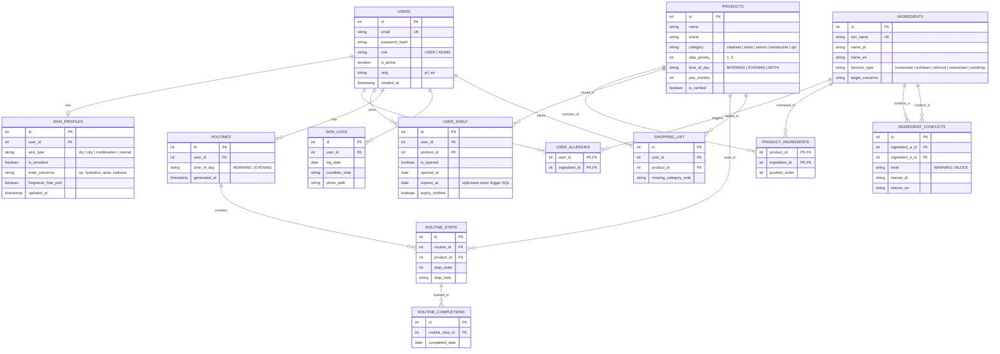

# SkinHarmony

Aplikacja webowa, która pomaga użytkownikom organizować codzienną pielęgnację skóry. Rozwiązuje problem samodzielnego dobierania kosmetyków, sprawdzania ich składów i układania rutyny pielęgnacyjnej. Jest przeznaczona dla osób, które chcą lepiej poznać potrzeby swojej skóry i uporządkować posiadane kosmetyki.

Na podstawie ankiety, profilu użytkownika, posiadanych kosmetyków i określonych reguł aplikacja proponuje poranną oraz wieczorną rutynę pielęgnacyjną. Umożliwia również analizę składów kosmetyków, w tym sprawdzanie potencjalnych konfliktów między składnikami INCI. Dodatkowo pozwala tworzyć listę zakupową, prowadzić dziennik pielęgnacji oraz kontrolować terminy przydatności kosmetyków po otwarciu (PAO).

Aplikacja działa na podstawie własnej bazy danych i określonych reguł. Nie zastępuje konsultacji dermatologicznej ani nie diagnozuje chorób skóry. Przedstawiane wyniki mają charakter informacyjny i pomocniczy.

---

## Spis treści i dokumentacja

1. [Opis problemu i rozwiązania](#1-opis-problemu-i-rozwiązania)
2. [Funkcje aplikacji](#2-funkcje-aplikacji)
3. [Tech stack](#3-tech-stack)
4. [Wymagania i szybki start](#4-wymagania-i-szybki-start)
5. [Konfiguracja środowiska (.env)](#5-konfiguracja-środowiska-env)
6. [Adresy usług i konta demonstracyjne](#6-adresy-usług-i-konta-demonstracyjne)
7. [Zasady developmentu (Git workflow)](#7-zasady-developmentu-git-workflow)
8. [Architektura, struktura katalogów i ERD](#8-architektura-struktura-katalogów-i-erd)
9. [Routing, API, CRON i testy](#9-routing-api-cron-i-testy)
10. [Bezpieczeństwo (Security Bingo) i dostępność (WCAG)](#10-bezpieczeństwo-security-bingo-i-dostępność-wcag)
11. [Zrzuty ekranu i Deploy](#11-zrzuty-ekranu-i-deploy)
12. [Autor](#12-autor)

---

## 1. Opis problemu i rozwiązania

* **Problem:** Składy kosmetyków (INCI) są często niezrozumiałe dla przeciętnego użytkownika, przez co wiele osób kupuje produkty bez pełnej wiedzy o ich składzie i dopasowaniu do potrzeb swojej skóry. Użytkownicy mają trudności z doborem kosmetyków, ustaleniem prawidłowej kolejności ich stosowania oraz łączeniem składników aktywnych. Zdarza się, że nieświadomie łączą substancje, które mogą wzajemnie osłabiać swoje działanie lub zwiększać ryzyko podrażnień, np. retinol z kwasami AHA/BHA. Dodatkowym problemem jest brak kontroli nad terminami przydatności kosmetyków po otwarciu (PAO - Period After Opening), co może prowadzić do używania produktów po zalecanym czasie. W efekcie użytkownicy mają trudności z bezpiecznym i świadomym dobieraniem kosmetyków oraz tworzeniem odpowiedniej rutyny pielęgnacyjnej dostosowanej do potrzeb swojej skóry.
* **Odbiorcy:** Osoby chcące świadomie i regularnie dbać o cerę (`USER`) oraz kosmetolodzy/administratorzy zarządzający bazą składników INCI i regułami ich interakcji (`ADMIN`).
* **Rozwiązanie:** **SkinHarmony** przeprowadza ankietę potrzeb skóry, pozwala prowadzić wirtualną półkę kosmetyków i automatycznie generuje poranną oraz wieczorną rutynę pielęgnacyjną. Każda ręczna modyfikacja planu przez użytkownika oraz każdy skład wklejony podczas zakupów w drogerii są na bieżąco weryfikowane pod kątem konfliktów chemicznych, alergii i dopasowania do profilu skóry.

---

## 2. Funkcje aplikacji

| Obszar | Co robi |
|---|---|
| **Strona startowa i Auth** | Prezentacja funkcji aplikacji, rejestracja, logowanie, wylogowanie oraz obsługa sesji i ról (`USER`, `ADMIN`). |
| **Ankieta i profil skóry** | Kwestionariusz punktowy określający rodzaj cery, problemy skórne, cele pielęgnacyjne oraz alergie na składniki. |
| **Wirtualna półka (PAO)** | Zarządzanie posiadanymi kosmetykami, automatyczne wyliczanie daty ważności od otwarcia (trigger SQL) i wskazywanie braków. |
| **Generator i weryfikator rutyny** | Automatyczne układanie planu porannego i wieczornego oraz trójstopniowa weryfikacja zmian użytkownika przez Fetch API (*Pasuje* / *Wymaga uwagi* / *Blokada*). |
| **Sprawdzanie zmian rutyny** | Sprawdza proponowane zmiany według ustalonych reguł i wyświetla ewentualne ostrzeżenia.|
| **Analizator składu INCI** | Szybkie sprawdzanie składu nowego kosmetyku podczas zakupów pod kątem profilu cery, obecnej rutyny oraz zapis do listy zakupowej. |
| **Dziennik skóry i postępy** | Codzienne odznaczanie wykonanych kroków rutyny, notatki o reakcjach skóry oraz bezpieczny upload zdjęć porównawczych. |
| **Powiadomienia (CRON + Mail)** | Cykliczne sprawdzanie zbliżających się terminów ważności kosmetyków i wysyłka przypomnień e-mail przez PHPMailer. |
| **Panel Administratora** | Zarządzanie katalogiem kosmetyków, bazą składników INCI, regułami konfliktów, kontami użytkowników oraz zgłoszeniami błędów. |
| **Ustawienia i UI** | Przełącznik motywu jasnego/ciemnego (`data-theme`), zmiana języka interfejsu i komunikatów (`PL` / `EN`), obsługa z klawiatury (WCAG). |

---

## 3. Tech stack

| Warstwa | Technologie |
|---|---|
| **Backend** | PHP 8.3 (OOP, architektura MVC, PDO, Composer autoloading) |
| **Baza danych** | PostgreSQL 16 (relacje, widoki, funkcje, wyzwalacze, transakcje) |
| **Frontend** | Semantyczny HTML5, CSS3 (Custom Properties, Media Queries, Dark/Light mode), Vanilla JavaScript (ES6+, Fetch API) |
| **Serwer HTTP** | Nginx |
| **Usługi dodatkowe** | PHPMailer + Mailpit (obsługa SMTP), CRON (zadania cykliczne) |
| **Testy i jakość** | PHPUnit (testy jednostkowe), Lighthouse / WAVE (audyt WCAG) |
| **Konteneryzacja** | Docker & Docker Compose |
| **Kontrola wersji** | Git, GitHub |

---

## 4. Wymagania i szybki start

Do uruchomienia projektu wymagane są wyłącznie zainstalowane narzędzia **Git** oraz **Docker Desktop** (z obsługą Docker Compose).

```bash
# 1. Sklonuj repozytorium
git clone [https://github.com/Monia895/Projekt_aplikacja_internetowa.git](https://github.com/Monia895/Projekt_aplikacja_internetowa.git)
cd Projekt_aplikacja_internetowa

# 2. Utwórz plik konfiguracyjny na podstawie szablonu
cp .env.example .env

# 3. Zbuduj i uruchom kontenery w tle
docker compose up --build -d

# 4. Zainstaluj zależności Composera wewnątrz kontenera PHP
docker compose exec php composer install

# 5. Sprawdzenie działania kontenerów
docker compose ps

# 6. Wyświetlenie logów
docker compose logs -f

# 7. Zatrzymanie aplikacji
docker compose down

```

Baza danych PostgreSQL zostanie automatycznie zainicjalizowana strukturą tabel, widokami, triggerami oraz danymi demonstracyjnymi z pliku `docker/postgres/init.sql`.

---

## 5. Konfiguracja środowiska (.env)

Wszystkie dane wrażliwe oraz konfiguracja usług znajdują się w pliku `.env` (plik jest ignorowany przez Gita). W repozytorium znajduje się bezpieczny szablon `.env.example`:

| Zmienna | Opis | Przykładowa wartość (lokalna) |
|---|---|---|
| `APP_ENV` | Środowisko uruchomieniowe | `development` |
| `APP_PORT` | Port serwera HTTP Nginx | `8080` |
| `DB_HOST` | Nazwa usługi bazy danych w sieci Docker | `db` |
| `DB_PORT` | Wewnętrzny port PostgreSQL | `5432` |
| `DB_NAME` | Nazwa bazy danych | `skinharmony` |
| `DB_USER` | Użytkownik bazy danych | `skinharmony_user` |
| `DB_PASS` | Hasło bazy danych | `secret_local_pass` |
| `MAIL_HOST` | Host serwera SMTP (Mailpit) | `mailpit` |
| `MAIL_PORT` | Port SMTP | `1025` |
| `UPLOAD_DIR` | Ścieżka zapisu przesyłanych zdjęć | `/var/www/html/storage/uploads` |

---

## 6. Adresy usług i konta demonstracyjne

### Lokalnie uruchomione usługi:
* **Aplikacja webowa:** `http://localhost:8080`
* **Panel pocztowy Mailpit (podgląd e-maili z CRONa):** `http://localhost:8025`
* **Baza danych PostgreSQL (dostęp z hosta):** `localhost:5432`

### Konta demonstracyjne (załadowane z `init.sql`):

| Rola | E-mail | Hasło | Zakres możliwości podczas demo |
|---|---|---|---|
| **USER** | `user@skinharmony.local` | `UserPass123!` | Wypełniona ankieta skóry, kosmetyki na półce, wygenerowana rutyna, dziennik skóry, lista zakupów. |
| **ADMIN** | `admin@skinharmony.local` | `AdminPass123!` | Dostęp do panelu `/admin`, edycja katalogu kosmetyków, bazy składników INCI oraz reguł konfliktów. |

---

## 7. Zasady developmentu (Git workflow)

W projekcie obowiązuje praca na osobnych gałęziach funkcjonalnych oraz małe, atomowe commity zgodne z konwencją **Conventional Commits** w języku angielskim.

### Codzienny rytm pracy:
```bash
git switch main
git pull --ff-only
git switch -c feature/nazwa-zadania

# praca nad kodem i małe, logiczne commity
git status
git add konkretny-plik.php
git diff --cached
git commit -m "feat: describe completed change"

git push -u origin feature/nazwa-zadania
```

### Prefiksy commitów:
* `feat:` – nowa funkcja (np. `feat: add skin quiz score evaluation`)
* `fix:` – naprawa błędu (np. `fix: validate negative PAO months input`)
* `docs:` – dokumentacja (np. `docs: update ERD diagram in readme`)
* `refactor:` – zmiana struktury kodu bez zmiany działania (np. `refactor: extract conflict rule repository`)
* `test:` – testy jednostkowe (np. `test: cover routine verification rules`)
* `chore:` – konfiguracja i narzędzia (np. `chore: configure mailpit container in docker compose`)

---

## 8. Architektura, struktura katalogów i ERD

Aplikacja realizuje wzorzec **MVC (Model-View-Controller)** rozszerzony o warstwę **Serwisów** (logika biznesowa i reguły pielęgnacyjne) oraz **Repozytoriów / DAO** (komunikacja z bazą PostgreSQL przez PDO).

**Kierunek zależności:**
`Router` ➔ `Middleware (Auth/Role/CSRF)` ➔ `Controller` ➔ `Service` ➔ `Repository (PDO)` ➔ `PostgreSQL`

### Struktura projektu:
```text
├── bin/                    # Skrypty CLI oraz zadania cykliczne CRON
├── config/                 # Konfiguracja połączenia z bazą, pocztą i środowiskiem
├── docker/                 # Pliki Dockerfile (PHP, Nginx) oraz skrypt init.sql
├── lang/                   # Słowniki tłumaczeń interfejsu i walidacji (pl.php, en.php)
├── public/                 # Punkt wejścia (index.php), arkusze CSS, skrypty JS
├── src/
│   ├── Controller/         # Kontrolery obsługujące żądania HTTP i zwracające widoki/JSON
│   ├── Core/               # Router, Request, Response, Session, Database, Translator
│   ├── Middleware/         # Weryfikacja sesji, ról (USER/ADMIN) oraz tokenów CSRF
│   ├── Model/              # Klasy encji i obiektów wartości (User, Product, Ingredient, Routine)
│   ├── Repository/         # Zapytania SQL (PDO) i mapowanie danych na obiekty PHP
│   └── Service/            # Obiektowa logika biznesowa (Generator rutyny, Analizator INCI, Upload)
├── storage/uploads/        # Bezpieczny katalog na zdjęcia użytkowników (poza kodem źródłowym)
├── templates/              # Szablony widoków HTML podzielone na layouty, strony i komponenty
├── tests/                  # Testy jednostkowe PHPUnit
├── .env.example            # Szablon zmiennych środowiskowych
└── docker-compose.yml      # Definicja usług (php, nginx, db, mailpit)
```

### Diagram ERD bazy danych (Mermaid):



---

## 9. Routing, API, CRON i testy

### Przykładowe trasy (Routing):
* **Trasa statyczna:** `GET /dashboard`, `GET /quiz`, `POST /login`
* **Path parameter z walidacją ID:** `GET /products/{id}` (zwraca `400`/`404` dla niepoprawnego lub nieistniejącego ID)
* **Query parameter:** `GET /products?category=serum&concern=hydration`
* **Regex pattern:** `GET /inci/(?<slug>[a-z0-9\-]+)` (karta składnika INCI po identyfikatorze tekstowym)

### Endpointy Fetch API (AJAX):
* `GET /api/ingredients/search?q=niacin` – dynamiczne wyszukiwanie składników i produktów bez przeładowania strony.
* `POST /api/routine/verify-change` – przyjmuje JSON z proponowaną zmianą w rutynie, uruchamia reguły weryfikacji i zwraca status (`OK`, `WARNING`, `BLOCKED`) wraz z uzasadnieniem.
* `POST /api/analyzer/check-inci` – analizuje wklejony skład kosmetyku w sklepie względem profilu skóry i aktualnej rutyny użytkownika.

### Uruchomienie testów jednostkowych (PHPUnit):
```bash
docker compose exec php ./vendor/bin/phpunit
```

### Uruchomienie i testowanie zadania CRON (powiadomienia PAO):
```bash
docker compose exec php php bin/cron-pao-reminder.php
```
Skrypt odpytuje widok SQL `v_expiring_shelf_items`, wysyła e-maile przez PHPMailer (widoczne pod `http://localhost:8025`) i oznacza flagę `expiry_notified = true`.

---

## 10. Bezpieczeństwo (Security Bingo) i dostępność (WCAG)

### Security Bingo:
| Zagadnienie | Sposób realizacji w projekcie | Lokalizacja w kodzie |
|---|---|---|
| **Hashowanie haseł** | `password_hash(..., PASSWORD_ARGON2ID)` oraz `password_verify()` | `src/Service/AuthService.php` |
| **SQL Injection** | Wyłącznie sparametryzowane zapytania PDO (`prepare` / `execute`) | `src/Repository/*.php` |
| **XSS (kodowanie wyjścia)** | Funkcja pomocnicza `e()` używająca `htmlspecialchars(..., ENT_QUOTES, 'UTF-8')` | `templates/**/*.php` |
| **CSRF** | Token kryptograficzny w sesji weryfikowany dla każdego żądania `POST` | `src/Middleware/CsrfMiddleware.php` |
| **Autoryzacja na serwerze** | Sprawdzanie sesji i roli (`USER` / `ADMIN`) przed akcją kontrolera (zwrot `401`/`403`) | `src/Middleware/RoleMiddleware.php` |
| **Bezpieczny Upload** | Weryfikacja rozmiaru, `finfo_file()` (MIME), losowa nazwa pliku, zapis poza `public/` | `src/Service/ImageUploadService.php` |
| **Bezpieczna sesja** | `session_regenerate_id(true)` po logowaniu, flagi `HttpOnly`, `SameSite=Lax` | `src/Core/Session.php` |

### Raport WCAG i Dark/Light Mode:
* Motyw kolorystyczny jest obsługiwany atrybutem `data-theme` na elemencie `<html>`, zapisywany w `localStorage` i inicjalizowany w sekcji `<head>` przed renderowaniem (brak efektu FOUC).
* *Miejsce na zrzut i wynik audytu Lighthouse / WAVE przed oddaniem projektu.*

---

## 11. Zrzuty ekranu i Deploy

* **Adres wdrożonej aplikacji (Deploy):** `https://skinharmony-demo.example.com` *(do uzupełnienia przy wdrożeniu)*
* **Zrzuty ekranu:** *(Miejsce na co najmniej 5 zrzutów w widoku mobilnym i 5 w widoku desktopowym po ostylowaniu widoków).*

---

## 12. Autor

* **[Monika Toczek]** — Architektura MVC, baza danych PostgreSQL, logika biznesowa (generator rutyny, analizator INCI), autoryzacja, interfejs użytkownika, testy i konfiguracja Docker.